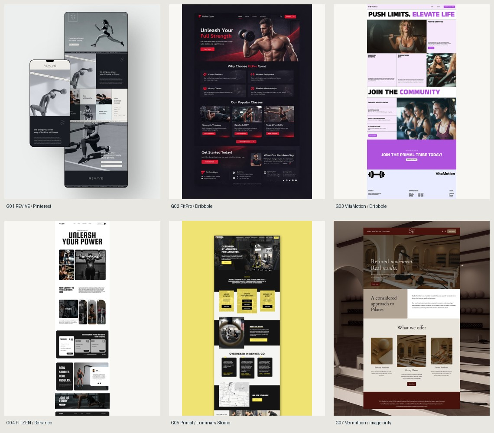

# ジム向けWebサイト・LP デザイン参考調査

調査日：2026-11-12
目的：ヘッドレスCMSテンプレートの商品化に向け、雰囲気・利用料金・顧客・営業形態・立地を比較し、次のデザイン検討に使う。
前提：[テンプレート販売の前提](template-business-premises.md)。テンプレート3万円程度、任意の導入代行5万円程度を想定。今回の「価格帯」は原則として**ジム利用者が払う料金**であり、サイト制作費・テンプレート価格ではない。

## 1. 調査の読み方

公式サイト12件と、デザイン参考7件を収集した。後者はPinterest、Dribbble、Behance、制作会社の実績、Framer Marketplaceから選定した。

- **確認した事実**：公式のサービス内容、掲載料金、所在地・店舗案内、取得できたページのセクション・リンク。
- **デザインの観察**：公開されているデザイン画像を目視。公式サイトの一部ではOGP画像のみ取得しているため、サイト全体の配色・レイアウトを確認したものとは扱わない。
- **解釈・仮説**：雰囲気の分類、想定顧客、立地との相性、テンプレートへの適用案。実際の会員属性・所得・成約率を調査したものではない。
- **未確認**：ページが取得できない、画像内に料金がある、条件が読み取れない場合は明記。以前の料金や比較サイトの数字で補完しない。
- ログイン済みのPinterestボードは作成していない。個別Pinの画像は取得・目視できたが、Pin本文は403で取得できなかった。
- 実機ブラウザでの全ページ・スマホ操作・動画・アニメーションの確認は未実施。見栄えの良さから集客成果が高いと断定しない。

料金は確認日時点の掲載例。入会金・事務手数料・オプション・最低期間・キャンペーンをすべて含む総額ではない。海外料金は円に換算しない。月会費・回数券・体験料金を同じ単位で比較しない。

## 2. デザイン画像の比較ボード

下の6点は、取得した公開画像を縮小した比較用プレビュー。公式サイトの最新画面を撮影したものではなく、投稿作品・制作事例画像を含む。個別出典と確認状況は第5章に記載。

| ID | 画像の方向性 | 主に見るところ | 注意点 |
| --- | --- | --- | --- |
| G01 REVIVE | モノクロ、編集的、身体の動き | 写真と面の切り替え、余白、ブランドの統一感 | 元作者・稼働店舗は未確認 |
| G02 FitPro | 黒と赤、筋力、強い訴求 | 写真と見出しの関係、サービス区分 | FigmaのUI作品。事業成果の証拠ではない |
| G03 VitaMotion | ラベンダー、力強い女性、太い文字 | 女性向けを柔らかさだけで表さない方向 | コンセプト作品 |
| G04 FITZEN | 白黒、大きな文字、写真の大小 | 情報の強弱、写真の組み合わせ | 表示される料金・推薦文は実店舗データとして使わない |
| G05 Primal | 黒と黄、スポーツ、実際の施設 | 利用目的別の入口、コーチ、所在地 | 制作事例時点の画像 |
| G07 Vermillion | 暖色、ボルドー、落ち着いた空間 | 内装と画面の色、写真の質感 | 画像は取得できたが掲載ページは404。補助参考 |

画像は比較・出典確認用。販売テンプレートの写真・文章・ロゴとして転載しない。新しく作る際は独自素材または利用・再配布条件に合う素材を使う。

## 3. 雰囲気・顧客・ビジネスの分類

同じ「ジム」でも来店理由は異なる。性別だけでなく、何を求め、何に不安を感じるかで分ける。

| 分類 | 雰囲気の方向性 | 想定する顧客の目的 | 料金・営業形態の傾向※ | 立地との相性の仮説 | 主な参考 |
| --- | --- | --- | --- | --- | --- |
| A 地域密着・相談しやすさ | 明るい、自然体、トレーナーの顔 | 初心者、継続、近所で相談 | 月回数・回数券、予約制パーソナル | 住宅地、地方都市、生活圏 | R01 BUDDYB、R02 かたぎり塾 |
| B ウェルネス・生活へのなじみ | 清潔、余白、柔らかい光 | 習慣化、身体の整え方、居心地 | パーソナル月回数、少人数・継続制 | 住宅地、駅近、生活動線 | R03 UNDEUX、G06 Alora、G07 |
| C 専門性・プレミアム | 抑制、施設・専門家の質、洗練 | 個別指導、設備、付加価値 | 回数券・指導プラン、複合会員制 | 都心、オフィス街、目的来店 | R04 BEYOND、R05 Third Space |
| D 価格・利便性・24時間 | 分かりやすい、機能・数字中心 | 安く通う、時間に縛られない | 月会費、セルフ利用 | 駅前、住宅地、ロードサイド | R06 chocoZAP、R07 FIT PLACE24 |
| E 高揚感・音楽・クラス体験 | 暗い空間、動き、強いコントラスト | 気分転換、没入、グループ運動 | クラス回数制、月会費、チケット | 都心駅近、商業エリア | R08 b-monster、R09 1Rebel |
| F コミュニティ・運動文化 | 人・動き・施設、参加感 | 仲間、技術向上、多様なクラス | 会員制、クラスパック、ドロップイン | 都市の生活圏、倉庫型、地域拠点 | R10 BLOK、R11 CrossFit Asia、G05 |
| G 健康習慣・始めやすさ | 親しみ、大きな説明、安心感 | 運動の習慣、短時間、続けやすさ | 月会費、短時間サーキット | 住宅地、商業施設、日常動線 | R12 カーブス |

※市場の平均価格・統計ではなく、今回の参考例から整理した営業形態の違い。高級感と実際の料金は別軸。月2回のパーソナルと月12回のグループを単純な高低で比べない。

## 4. 実在する公式サイト12件

### R01 BUDDYB PERSONAL GYM：地域の個人店を想定する基準

- 公式：[トップ・1ページ型サイト](https://buddyb-personal-gym.com/)
- **場所**：沖縄県名護市。独立した地域店舗の参考。
- **モデル・料金**：完全個室パーソナル、ダイエット・ボディメイク。継続コースの正確な金額は今回未採録。公開HTMLで体験・入会金の期間限定訴求は確認できたが、通常継続料金と混ぜない。
- **顧客・雰囲気の解釈**：身近な担当者に相談しながら通いたい人向け。本人制作実績との接続があり、最初のテンプレートの対象を考えやすい。
- **確認できた構成**：特徴、事例、料金、トレーナー、アクセス、LINE相談。営業時間・手ぶら・指導者の情報が早い段階にある。
- **見るポイント**：一店舗で判断に必要な情報が揃うこと。施設や担当者を確認してから相談できること。
- **適用案**：A系統の検討基準。配色より、生活圏・担当者・相談方法の伝わり方を見る。
- **確認範囲**：公式HTML。完成画面全体の目視は未実施。最新料金・駐車条件は店舗に確認する。

### R02 かたぎり塾：継続するパーソナルの不安を減らす

- 公式：[トップ](https://katagirijuku.jp/)／[料金](https://katagirijuku.jp/price)
- **場所**：全国の店舗。各店舗のアクセスと生活圏を確認する方式。
- **モデル・料金例**：月回数型パーソナル。公式の月8プランは月59,400円（税込）。店舗ごとの差があるため、個別店舗で再確認。
- **顧客・雰囲気の解釈**：運動初心者、無理なく続けたい人。公開OGPは白を基調に、指導中の人物とブランドを見せる。
- **確認できた構成**：悩み、サービスの特長、事例、プラン、店舗検索。貸出物や個室など利用時の条件を説明する。
- **見るポイント**：体験の流れ、料金に含むもの、現実的な継続方法。
- **適用案**：A・B系統。全国検索は省き、単店舗では担当者・料金・行き方を直接提示する案に転用できる。
- **確認範囲**：公式HTML・料金・公開OGP画像。全体の色や動作を再現した分析ではない。

### R03 UNDEUX SUPERBODY：女性向けの継続・集中特化

- 公式：[トップ](https://www.diet-undeux.jp/)／[料金](https://www.diet-undeux.jp/price/)／[LP例](https://www.diet-undeux.jp/lp/life-all-sokyu/)
- **場所**：銀座・青山・梅田など複数の都市部スタジオ。店舗・エリア別の案内がある。
- **モデル・料金例**：女性専用パーソナル。公式料金ページはスタンダード月18,200円〜、コミット月79,200円と表示。回数・エリア・条件が異なり、抜粋金額の税区分は今回確定できていない。
- **顧客・雰囲気の解釈**：女性向けの身体づくり・食事サポートと生活の両立。月回数を選ぶ継続と集中プランを使い分ける。
- **見るポイント**：初めての方への案内、プラン比較、スタジオ、無料体験。トップとLPの役割の違い。
- **適用案**：B系統のサービス整理に有用。女性向けを一律にピンクで表現せず、運動の目的と空間の実態から選ぶ。
- **確認範囲**：公式ページの内容・リンク。全体のビジュアルは未検証のため配色を断定しない。

### R04 BEYOND：トレーナーと専門性を比較材料にする

- 公式：[トップ](https://beyond-gym.com/)／[料金・プラン](https://beyond-gym.com/price/)
- **場所**：全国。都心の駅周辺を含む店舗ごとの案内がある。
- **モデル・料金帯**：回数券・指導コースのあるパーソナル。今回は画像等を含む料金の正確な条件を採録できず、金額は未確認。専門性を比較する系統に分類するが、価格順位は付けない。
- **顧客・雰囲気の解釈**：担当トレーナーや指導内容を確認して選びたい人。
- **確認できた入口**：トレーナー一覧、料金、利用者の声、店舗、無料カウンセリング。
- **見るポイント**：指導者を選ぶ理由と、相談までの接続。派手な運動写真だけで信用を作らない。
- **適用案**：C系統。独立トレーナーなら、多人数の一覧より本人の経歴・得意分野・指導方針に絞る。
- **確認範囲**：公式HTML。全体の配色・モーション・現在の価格は要確認。

### R05 Third Space：施設と生活体験を伝えるプレミアム型

- 公式：[トップ](https://www.thirdspace.london/)／[会員案内](https://www.thirdspace.london/membership/)
- **場所**：ロンドンの複数クラブ。都心の生活・仕事の動線と結び付く例。
- **モデル・料金帯**：公式がラグジュアリーヘルスクラブとして案内。施設、クラス、パーソナル、回復・栄養等を扱う。正確な現在会費は今回の取得範囲では未確認。
- **顧客・雰囲気の解釈**：設備や空間も含めた会員体験を重視する人。プレミアムは公式の位置づけで、所得属性の調査ではない。
- **見るポイント**：クラブ、トレーナー、クラス、ウェルネスの分類。料金の安さ以外の選択理由。
- **適用案**：C系統のブランド設計の参考。小規模店に多数の施設・クラスの機能をそのまま移植しない。
- **確認範囲**：公式ページのテキスト。直接画像取得は403。全画面のビジュアル判断は保留。

### R06 chocoZAP：低い参加ハードルを伝える

- 公式：[トップ](https://chocozap.jp/)／[料金](https://chocozap.jp/price)
- **場所**：全国の生活圏。店舗・設備ごとに条件を確認する方式。
- **モデル・料金例**：24時間セルフ型の月額制。月3,278円（税込）、年額32,780円（税込）の掲載。設備・サービスは店舗差がある。
- **顧客・雰囲気の解釈**：初心者、短時間・手軽さ・料金の分かりやすさを求める人。公開OGPは白・黄の親しみやすいブランド表現。
- **見るポイント**：月額と支払方法、利用条件、店舗検索、初めての方向け案内。
- **適用案**：D系統。専門性より利用のハードルを下げたい場合の情報整理。単店舗では営業時間・入館・スタッフ在店時間を分ける。
- **確認範囲**：公式HTML・料金・OGP。全国型システムの実装は参考対象外。

### R07 FIT PLACE24：価格と設備を同時に示す

- 公式：[LP型トップ](https://fitplace.jp/lp202211/)
- **場所**：全国の店舗。立地条件は店舗別。
- **モデル・料金例**：本格的な24時間フィットネス。公式タイトルに月3,278円（税込）〜の掲載。契約期間・初期費用・年次費用等の全条件は今回未採録で、総額比較には使わない。
- **顧客・雰囲気の解釈**：設備と価格、通える時間を比較したい人。公開OGPは黒と明るい黄緑のロゴ。
- **見るポイント**：料金と設備・店舗への接続。価格を強く出す場合の適用条件の扱い。
- **適用案**：D系統。トレーニング感を強めた色の方向性。ただしOGPの配色だけで全ページのスタイルを確定しない。
- **確認範囲**：公式LPのHTML・タイトル・OGP。

### R08 b-monster：音楽と暗闇という体験を先に伝える

- 公式：[トップ](https://www.b-monster.jp/)／[料金](https://www.b-monster.jp/price/)
- **場所**：新宿・銀座・表参道・名古屋・梅田など、都市・商業エリアのスタジオ。
- **モデル・料金例**：暗闇ボクシングのクラス制。Regularは月12回16,500円（税込）。入会事務手数料16,500円等の条件があり、店舗・プランによって追加オプションも確認が必要。
- **顧客・雰囲気の解釈**：運動と同時に気分転換や没入感を求める人。これは訴求からの解釈で実際の会員年代ではない。
- **確認できた入口**：初回体験、初心者、スタジオ、パフォーマー、プログラム、料金。
- **見るポイント**：通常の筋力トレーニングとの体験の違いを先に伝え、その後に通い方を示す。
- **適用案**：E系統。写真・動画の質が重要。初期テンプレートは静止画でも成立する案を考える。
- **確認範囲**：公式HTML・料金。全体のビジュアル・動きは未検証。

### R09 1Rebel：プログラムを選んで参加する都市型フィットネス

- 公式：[英国サイト](https://www.1rebel.com/en-gb)
- **場所**：英国・ロンドン等のブランド例。今回の参照は英国版。
- **モデル・料金例**：クラス型フィットネス。初回向け5セッション£59の掲載を確認。通常月会費ではなく、初回商品の価格。
- **顧客・雰囲気の解釈**：プログラムとスタジオ体験を選んで参加する人。
- **見るポイント**：初回向けの入口と既存会員の行動の違い。単発体験・複数回体験・通常利用を混同しない。
- **適用案**：E系統。価格を大きく出すときも、対象者・回数・期限を一緒に示す。
- **確認範囲**：公式HTML。全画面の見た目、通常プランの価格条件は未確認。

### R10 BLOK：デザイン・運動・コミュニティの組み合わせ

- 公式：[トップ](https://www.bloklondon.com/)／[料金](https://www.bloklondon.com/pricing)
- **場所**：英国・ロンドン。スタジオごとの空間と通い方を案内。
- **モデル・料金帯**：複数種のクラス、クラスパック・会員制。現在の通常金額は取得した本文では確認できず、未記載とする。
- **顧客・雰囲気の解釈**：運動を生活・文化・コミュニティに組み込む人。公開画像は身体の動きと光を使い、筋肉の誇張だけに寄らない。
- **確認できた入口**：クラス、スケジュール、スタジオ、料金、初回体験。
- **見るポイント**：多様なクラスを整理し、初回の人が選べる状態にすること。
- **適用案**：F系統。集合写真や実際の参加風景がある店舗に向く方向性。
- **確認範囲**：公式HTML・公開OGP画像。動作・最新料金は未検証。

### R11 CrossFit Asia：沖縄の地域性と来訪者導線

- 公式：[トップ・会員・アクセス](https://crossfitasia.com/)
- **場所**：沖縄県沖縄市胡屋。サイト記載の新拠点を参照。
- **モデル・料金例**：クラスとOpen Gym、ドロップイン。公式HTMLでAll Access月19,800円、Open Gym月13,000円を確認。税区分・初期費用は未確認。
- **顧客・雰囲気の解釈**：地域で継続する人と、沖縄を訪れて一時利用する人。言語切替・来訪者案内からの整理。
- **確認できた入口**：コーチ、会員、スケジュール、アクセス、ドロップイン、言語切替。
- **見るポイント**：通常会員と旅行・出張等の短期利用を分けること。
- **適用案**：F系統。英語が必要かは「沖縄だから」ではなく、店舗の実際の利用者と対応体制で決める。
- **確認範囲**：公式HTML・料金表記・OGP。開業イベントの日付・曜日等は本調査では採用しない。

### R12 カーブス：始めやすさと健康習慣を明確にする

- 公式：[トップ](https://www.curves.co.jp/)／[FAQ](https://www.curves.co.jp/faq/)
- **場所**：全国の生活圏・近隣店舗を検索する方式。
- **モデル・料金例**：女性専用、30分の健康フィットネス。公式トップの本文に店舗プラン月7,150〜8,360円（税込）、通常入会金16,500円（税込）の案内。コース・条件は再確認する。
- **顧客・雰囲気の解釈**：短時間で運動を習慣にしたい人。年齢や身体状況は見た目だけで決めず、商品対象を別途確認する。
- **確認できた入口**：近くの店舗、サービスの説明、利用者の成果、FAQ。文字サイズの案内もある。
- **見るポイント**：専門語を増やさず、何をどれくらい行うのかを説明すること。
- **適用案**：G系統。文字とコントラスト、電話・店舗案内の分かりやすさを優先したいケース。
- **確認範囲**：公式HTML・本文料金・OGP。一般利用者の年代分布は未調査。

## 5. Pinterest・作品集・制作事例・テンプレート7件

ここでは「見た目のアイデア」と「実在ビジネスの情報」を分ける。デザイン作品内の料金・会員数・推薦文を、市場の実績として引用しない。

### G01 REVIVE：Pinterestのモノクロ・ムーブメント表現

- 出典：[Pinterest個別Pin](https://www.pinterest.com/pin/website-homepage-design-for-fitness-gym--181551428719716645/)
- 確認：Pin本文は403。公開画像を取得して目視。元の作者・公式サイト・実店舗は未追跡。
- **観察**：モノクロの人物写真、濃い背景、区画ごとの写真と文字、帯状の小さな文字。PC・スマホのモックアップを同時に見せる。
- **分類**：Fの都会的な運動文化、Cのブランド表現に使う方向性。
- **顧客・価格・場所**：実在事業の情報は不明。画像の印象から高額会員制等と決め付けない。
- **持ち帰る着眼点**：動きのある写真でも、色数を抑えると統一感を作れる。日本語では細かい文字を増やさず、大きさを再設計する。
- 比較用画像：[縮小プレビュー](gym-design-reference-images/pinterest-revive.jpg)

### G02 FitPro：Dribbbleの黒・赤・筋力トレーニング

- 出典：[Fitpro Gym Web Experience UI / Israel Udo UI/UX](https://dribbble.com/shots/27242443-Fitpro-Gym-Web-Experience-UI)
- 確認：作品ページ・デザイン画像。作者はFigma制作と説明している。
- **観察**：黒い背景と赤いボタン、大きなトレーニング写真、特徴の4区分、クラス3区分、下部の行動ボタン。
- **分類**：Eに近い高エネルギー、筋力・競技を重視するF向けの方向性。
- **顧客・価格・場所**：実際の利用者・料金・店舗所在地は未確認。画像内の連絡先も店舗の実在証明に使わない。
- **持ち帰る着眼点**：強い写真とボタンのコントラスト。初心者向けの店では圧迫感が適切かを検討する。
- 比較用画像：[縮小プレビュー](gym-design-reference-images/fitpro.jpg)

### G03 VitaMotion：Dribbbleの力強い女性向けコンセプト

- 出典：[VitaMotion / Edin Agbabic](https://dribbble.com/shots/25998465-VitaMotion-Elite-Performance-Gym)
- 確認：作品ページ・画像。作者が女性向けのパフォーマンス重視コンセプトと明記。
- **観察**：淡い紫の背景、鮮やかな紫、太い黒い文字、ウエイトトレーニングの写真、罫線で区切る面構成。
- **分類**：Bの「穏やかさ」と対照になる、女性向けF系統。
- **顧客・価格・場所**：顧客像はコンセプトの設定。実店舗・料金は未確認。
- **持ち帰る着眼点**：「女性向け＝淡色・美容・細い文字」に限定しない。筋力・競技・仲間を中心にした方向も成立する。
- 比較用画像：[縮小プレビュー](gym-design-reference-images/vitamotion.jpg)

### G04 FITZEN：Behanceの白黒・大きな文字

- 出典：[FITZEN / Chhavi Soni](https://www.behance.net/gallery/219908479/FITZEN-Gym-Website-UI-Design)
- 確認：作品ページ・画像。UIデザイン作品として扱う。
- **観察**：大きな縦長書体、白い余白、大小の写真、サービスの縦カード、濃色の料金セクション。
- **分類**：C・Fの現代的なトレーニング表現。
- **顧客・価格・場所**：画像にドル建てプランがあるが、実店舗の料金とは確認できない。作者の所在地をジム所在地に置き換えない。
- **持ち帰る着眼点**：写真量と文字の強弱。横スクロールの料金表や細い文字は、日本語・スマホでの比較しやすさを再検討する。
- 比較用画像：[縮小プレビュー](gym-design-reference-images/fitzen.jpg)

### G05 Primal Performance：制作会社が公開する実制作の例

- 出典：[Luminary Studioの制作事例](https://www.luminarystudio.co/portfolio/sports-performance-gym)／[事例から案内される公式サイト](https://www.primalperformance303.com/)
- 確認：制作会社の事例本文・公開デザイン画像。現在のジム公式サイトの全内容は未確認。
- **場所・モデル**：事例では米国デンバーのスポーツパフォーマンスジム。個人・競技者向けのサービス分類が見える。現在料金は未確認。
- **観察**：黒と黄、実際の施設写真、成人向け・競技力・競技復帰の入口、コーチ、利用者の声、地図。
- **分類**：F。筋肉の見た目だけでなく、利用目的で選ぶ構造の参考。
- **持ち帰る着眼点**：対象者別の入口と実在感。競技復帰など専門性が必要な表現を、資格・対応体制の確認なしに使わない。
- 比較用画像：[縮小プレビュー](gym-design-reference-images/primal.jpg)

### G06 Alora：販売されているFramerテンプレート

- 出典：[Framer Marketplace / Alora](https://www.framer.com/marketplace/templates/alora/)／[デモ](https://alorapilates.framer.website/)
- 確認：マーケットプレイスの説明・画像検索で公開プレビューを確認。デモ本体は今回取得できなかった。
- **分類**：Bの小規模リフォーマーピラティス・ウェルネス。
- **説明から確認**：余白・落ち着いた文字、クラス、講師紹介、料金、CMSブログ等を持つ商品。
- **価格の意味**：掲載$39はテンプレートの販売価格。ジムの会費でも、Next.jsの価格基準でもない。Single-Useの表示があり、実際の利用許諾は購入時に確認する。
- **持ち帰る着眼点**：完成見本だけでなく、編集できる内容・対象者・付属ページ・ライセンスも購入判断に必要。
- **顧客・場所**：想定業種のある商品で、特定の実在店舗の所在地・顧客データはない。

### G07 Studio Vermillion：掲載ページが消えた画像の補助参考

- 出典：[Hemma Digitalの掲載URL](https://www.hemmadigital.com/portfolio/studiovermillion)
- 確認：掲載ページは404。画像検索で発見した配信画像は取得・目視できた。実在店舗・制作案件としての現在の状況は未確認。
- **観察**：茶系・クリーム・ボルドー、明朝系の英字、内装の光、プライベート・グループ・初回の3区分。
- **分類**：B・Cの落ち着いた空間型。
- **顧客・価格・場所**：不明。画像内の設定を実店舗情報として使用しない。
- **持ち帰る着眼点**：内装と画面の色を合わせる方法。単にベージュにするだけではなく、撮影素材の色と質を揃える必要がある。
- **扱い**：主参考より優先度を下げる。見た目の比較用に限定。
- 比較用画像：[縮小プレビュー](gym-design-reference-images/vermillion.jpg)

## 6. 料金・顧客・営業形態の横断表

数値がない例も、公開料金を推測して埋めず、未確認のまま比較する。費用の高低は指導・利用回数等の違いを含む。

| 参考 | 確認したジム料金の例 | 営業形態 | 想定する選択理由の解釈 | 金額の注意 |
| --- | --- | --- | --- | --- |
| BUDDYB | 継続料金未採録 | 個室パーソナル | 地域・担当者・相談のしやすさ | 体験キャンペーンを通常価格にしない |
| かたぎり塾 | 月8回59,400円（税込）の掲載例 | 月回数パーソナル | 継続・手ぶら・個別指導 | 店舗ごとの違いあり |
| UNDEUX | 月18,200円〜／79,200円の掲載 | 女性専用、継続・集中 | 目的・生活に合わせたプラン | 回数・エリア・税区分を再確認 |
| BEYOND | 今回未確認 | パーソナル、回数券等 | 専門家・指導内容 | 支払月額とコース総額を分ける |
| Third Space | 今回未確認 | 複合プレミアム会員制 | 空間・施設・生活体験 | ブランドの高級訴求と実会費を分ける |
| chocoZAP | 月3,278円（税込） | 月額セルフ | 手軽さ・日常の利用 | 年払いは別契約条件 |
| FIT PLACE24 | 月3,278円（税込）〜のタイトル表示 | 24時間フィットネス | 料金・設備・時間 | 初期・年次・最低期間は未採録 |
| b-monster | 月12回16,500円（税込） | 音楽・暗闇クラス | 体験・没入・予約 | 入会手数料・オプション別 |
| 1Rebel | 初回5回£59 | 都市型クラス | 体験からの参加 | 通常月会費ではない |
| BLOK | 今回未確認 | クラス・パック・会員制 | 多様な運動・文化・コミュニティ | 最新の条件を直接確認 |
| CrossFit Asia | 月19,800円／Open Gym13,000円 | クラス・自主練・一時利用 | 継続・仲間・短期来訪 | 税区分・初期費用未確認 |
| カーブス | 月7,150〜8,360円（税込）の掲載 | 短時間・月会費 | 日常・短時間・始めやすさ | コース条件・入会金別 |

## 7. 場所ごとに変えるべき情報

これは地域住民の属性を断定する分類ではなく、来店方法・商圏によって確認すべき情報の仮説。

| 場所・商圏 | 先に確認する情報 | 合いそうな参考 | 避けたい決め付け |
| --- | --- | --- | --- |
| 都心の駅近・オフィス街 | 駅出口、徒歩ルート、夜の営業時間、着替え、予約枠 | BEYOND、UNDEUX、b-monster、Third Space | 都心なら全員高所得・高級志向 |
| 住宅地・近所で継続 | 日中・週末、担当者、家事・仕事との両立、実際の雰囲気 | かたぎり塾、カーブス、BUDDYB | 女性や子育て世帯だけが対象 |
| 地方都市・車利用 | 駐車場の写真・台数、入口、道路、雨天時、営業時間 | BUDDYBを起点に個別確認 | 地方なら低価格だけで選ばれる |
| 商業施設内 | フロア・入口、施設の営業時間、駐車サービス、利用条件 | カーブス等の各店舗ページ | 商業施設なら入館・駐車が必ず無料 |
| 倉庫型・競技・コミュニティ拠点 | 施設の広さ、器具、時間割、初参加・安全説明 | CrossFit Asia、Primal | 暗い写真なら競技者向けになる |
| 観光・出張の一時利用 | ドロップイン、予約手順、支払い、言語、持ち物 | CrossFit Asia | 沖縄なら全店英語サイトが必要 |
| オンライン併用 | 対応時間帯、提供方法、必要機材、対象地域 | 今回の主要12件とは別に追加調査 | 店舗向け写真と地図をそのまま使う |

## 8. テンプレート化に向けた候補

ここでは制作順の仮説だけを置く。ワイヤーフレーム・完成レイアウト・キャッチコピー・配色コードはまだ決めない。

### 候補A：地域のパーソナルジム

- 基準参考：BUDDYB、かたぎり塾。
- 比較する見た目：明るく自然な人物写真と、担当者が分かる構成。
- 買い手の仮説：個人店、開業・改装するパーソナルジム。
- 必要な情報：料金、担当者、施設、アクセス、体験・相談方法。
- 最初の候補とする理由：既存実績と対象が近く、店舗が用意する素材も想像しやすい。
- 後で確認：提供する更新項目、写真枚数、料金体系の違い、LINE以外の相談方法。

### 候補B：ウェルネス・清潔感のあるスタジオ

- 基準参考：UNDEUXのサービス整理、Alora、Vermillionの画像表現。
- 比較する見た目：余白、光、実際の内装、落ち着いた文字。
- 買い手の仮説：女性向けパーソナル、小規模ピラティス、身体づくりのスタジオ。
- 注意：性別で色を固定しない。VitaMotionの力強い表現も対照案として残す。
- 後で確認：個別指導とクラス制のどちらか。予約の動線が異なるため、単なる色違いにしない。

### 候補C：競技・筋力・コミュニティ

- 基準参考：Primal、CrossFit Asia、FitPro、VitaMotion。
- 比較する見た目：実際の運動、強い文字、明暗、クラス・コーチ。
- 買い手の仮説：ストレングス、少人数クラス、トレーナーの専門性が強い店。
- 注意：黒と赤の見た目だけで競技向けにしない。初参加の導線と指導内容が必要。
- 後で確認：時間割、クラス別説明、外部予約、ドロップインの要否。

### 初期に優先しない候補

- 全国チェーン型の店舗検索・会員アプリ・入退館管理を含む構成。
- 独自予約・決済・会員権限を内包する多機能プラットフォーム。
- 高品質動画・大量撮影を前提にしないと成立しないデザイン。
- 実在しない口コミ・成果・資格を埋めて完成品らしく見せるデモ。

これらはテンプレート3万円・導入代行5万円の標準範囲を超えやすい。外部サービスへの接続だけで済む部分と、追加開発が必要な部分を後で分ける。

## 9. 次のデザイン検討で選ぶこと

次は候補A〜Cのいずれかを選び、同じ顧客像・商品内容で2案程度の方向性を比較する。異なる価格帯・顧客像の参考を無差別に混ぜない。

1. **対象店舗**：誰向けの何の店か。個別指導かクラス制か。
2. **利用者の目的**：初めて・習慣・筋力・競技・気分転換のどれが中心か。
3. **利用料金の形**：月会費・回数券・コース・一時利用。
4. **商圏・来店方法**：駅・車・近所・一時来訪。
5. **写真の前提**：人物、施設、指導場面を現実に何枚用意できるか。
6. **主な行動**：LINE相談・Web体験予約・電話・見学・直接入会のどれか。
7. **更新する内容**：お知らせ、料金、担当者、クラスなど。

その後に、写真の扱い、書体、余白、色、情報の順番、スマホの画面、テキストを順に検討する。今回の調査ではまだ実装しない。

## 10. 確認上の制約・追加調査候補

- Pinterestは個別Pinの画像確認まで。ボード全体・元作者への遡及は未完了。
- デザイン画像は過去の制作時点を含む。運営中サイトの最新表示とは異なる可能性がある。
- Studio Vermillionは掲載ページ404のため、現役の営業事例として扱わない。
- FEELCYCLEの公式トップは403、RIZAP料金ページは取得できず、今回の主要例から外した。
- SANKOU!・Awwwards等も検索したが、今回の条件で根拠を確認できた個別例に絞り、未確認の受賞・掲載実績は書いていない。
- 全12公式サイトのPC・スマホ実機表示、フォーム、固定CTA、読み込み速度、アクセシビリティは未確認。採用候補を絞ってから点検する。
- 会員数・売上・CVR・広告費・継続率・顧客年代は未調査。サイトの雰囲気から成功・失敗を断定しない。
- 料金の未確認項目は、候補を決めた段階で店舗・公式ページを再確認する。

比較画像の出典対応は[画像ソース一覧](gym-design-reference-images/sources.json)にも保存した。元画像の原寸ファイルと取得HTMLは一時調査領域に置き、販売素材には追加していない。
